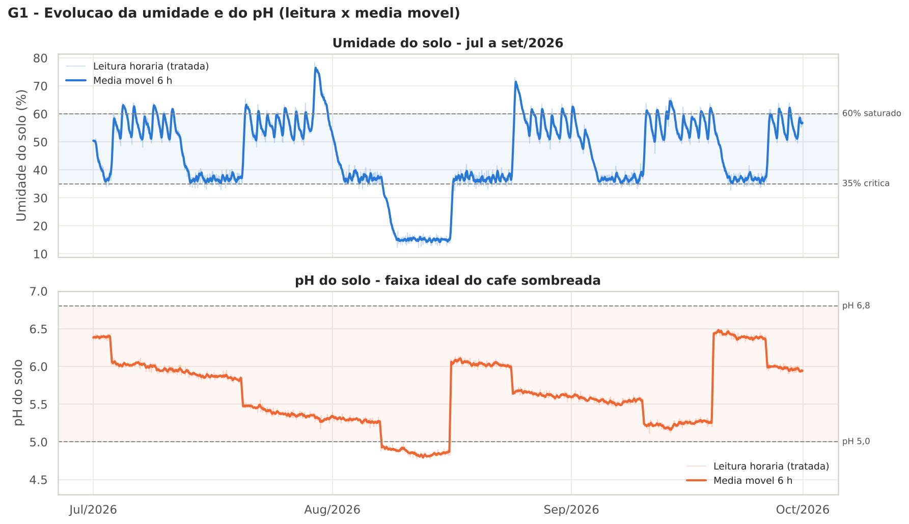
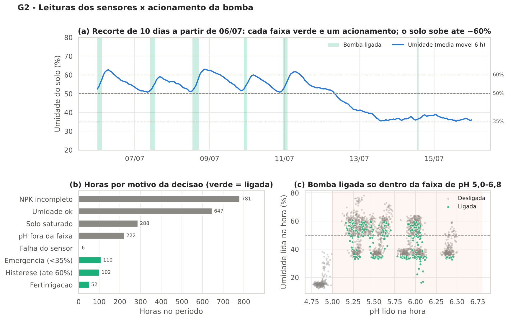
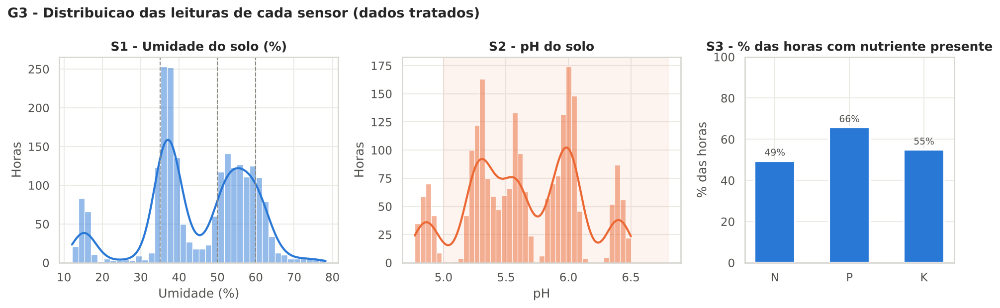
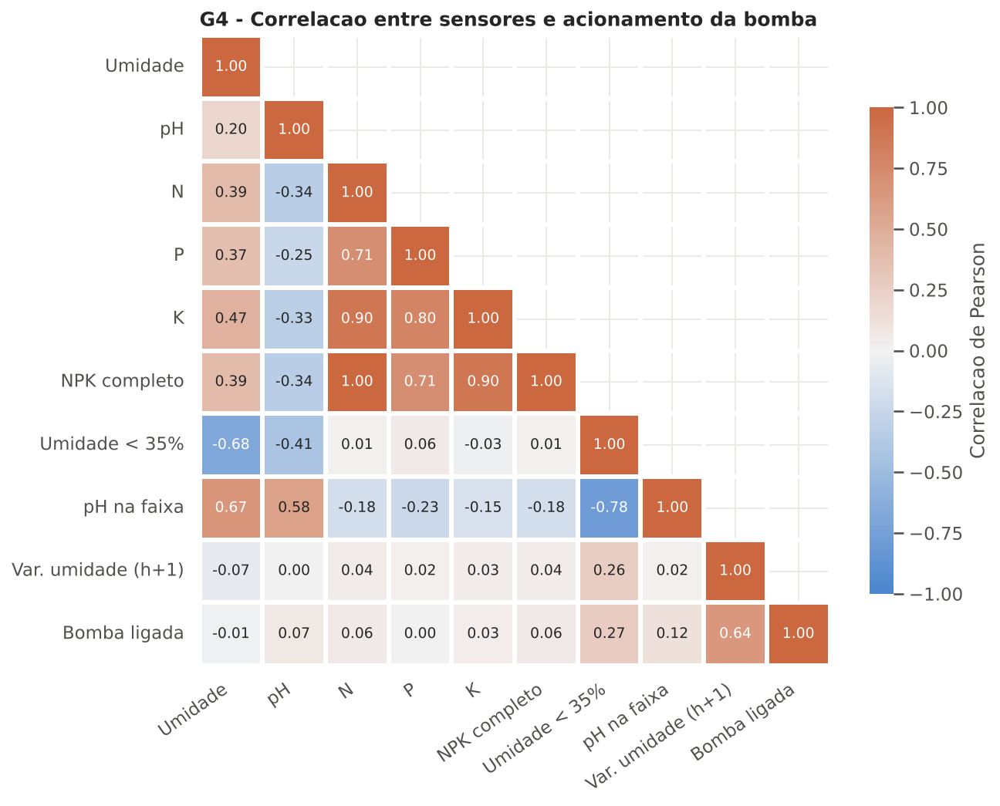
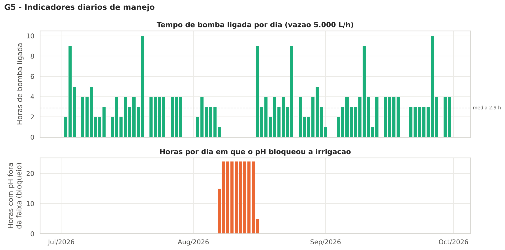

# FIAP - Faculdade de Informática e Administração Paulista

<p align="center">
<a href="https://www.fiap.com.br/">
  
</a>
</p>

<br>

# FarmTech Solutions — Fase 3: Etapas de uma Máquina Agrícola

## FarmTech Solutions

## Integrantes:
- <a href="https://github.com/">Raiane Sirlene da Silva</a> — RM 575984

## Professores:

### Tutor(a)
- <a href="#">Nome do Tutor</a>

### Coordenador(a)
- <a href="https://www.linkedin.com/in/andregodoichiovato/">André Godoi Chiovato</a>

---

## Descrição

Na Fase 2, o circuito com ESP32 passou a ler umidade, pH e nutrientes e a acionar a bomba de irrigação do café. Só que tudo existia apenas no Monitor Serial do Wokwi e se perdia a cada execução. **A Fase 3 dá memória ao sistema**: as leituras viram um histórico tratado, analisado e persistido em um banco Oracle, junto com os dados de manejo das Fases 1 e 2.

O trabalho tem duas frentes:

1. **Coleta e processamento (Python científico)** — o firmware ganhou um relógio simulado (1 ciclo = 1 hora) e passou a imprimir cada leitura como uma linha CSV. O log é exportado, limpo com Pandas e NumPy, suavizado com média móvel, transformado em indicadores de manejo e visualizado com Matplotlib e Seaborn.
2. **Armazenamento (Oracle)** — cinco tabelas com chave primária recebem as leituras, os acionamentos da bomba, os parâmetros da cultura (Fase 2), os talhões e insumos (Fase 1) e as linhas originais do Monitor Serial. Um programa Python faz a carga **repetível** (MERGE, sem duplicar registros) e oito consultas respondem às perguntas de gestão da fazenda.

```
 ESP32 (Wokwi)                Python científico                         Oracle
┌──────────────┐  log   ┌───────────────────────────────┐  carga  ┌──────────────────────┐
│ sketch.ino   │ ─────▶ │ exportar_csv_bruto.py         │ ──────▶ │ TB_LEITURA_SENSOR    │
│ 1 ciclo = 1h │  .txt  │ tratamento_dados.py           │ MERGE   │ TB_ACIONAMENTO_BOMBA │
│ linha DADOS  │        │  limpeza · média móvel        │         │ TB_PARAMETRO_CULTURA │
└──────────────┘        │  indicadores · gráficos       │         │ TB_MANEJO_TALHAO     │
 Fase 1 (CSV) ────────▶ │                               │         │ TB_LEITURA_BRUTA     │
 Fase 2 (JSON) ───────▶ └───────────────────────────────┘         └──────────┬───────────┘
                                                                             ▼
                                                              8 consultas de gestão (SQL)
```

---

## Origem dos dados das Fases 1 e 2

| Arquivo | Fase | Conteúdo | Vai para |
|---|---|---|---|
| `data/fase1/dados_fazenda.csv` | 1 | Talhões de café (retângulo) e cana (trapézio): área, ruas, metros lineares, insumo e litros — exportado pela opção 5 do `farmtech.py` | `TB_MANEJO_TALHAO` |
| `data/fase2/parametros_cultura_cafe.json` | 2 | Limites agronômicos do café usados pelo firmware (pH 5,0–6,8; umidade 35/50/60%), sensores S1/S2/S3, legenda dos motivos e a vazão da bomba | `TB_PARAMETRO_CULTURA` |
| `data/raw/monitor_serial_*.txt` | 2 → 3 | Texto do Monitor Serial do circuito da Fase 2 (agora com relógio simulado) | `TB_LEITURA_BRUTA` e, depois de tratado, `TB_LEITURA_SENSOR` / `TB_ACIONAMENTO_BOMBA` |

A cultura monitorada continua sendo o **café**, como nas fases anteriores.

---

# PARTE 1 — Coleta e processamento das leituras

## 1.1 Firmware com relógio simulado

`src/firmware/sketch.ino` mantém **exatamente** a lógica de irrigação da Fase 2 (mesmos pinos, limites e ordem de prioridade das regras). O que mudou:

- **Relógio simulado**: cada ciclo de 250 ms vale 1 hora, a partir de 01/07/2026 00:00. Cerca de 9 minutos de simulação produzem 3 meses de histórico.
- **Telemetria em CSV**: cada ciclo imprime uma linha pronta para exportar:

```
tipo,data_hora,ciclo,umidade,ph,ldr_bruto,nitrogenio,fosforo,potassio,bomba,motivo
DADOS,2026-07-01 07:00,8,48.2,6.01,1757,1,1,1,LIGA,FERTIRRIGACAO
```

- O motivo da decisão sai como **código** (sem vírgulas, para não quebrar o CSV):

| Código | Bomba | Regra |
|---|---|---|
| `FALHA_SENSOR` | desliga | DHT22 sem leitura |
| `SATURADO` | desliga | umidade ≥ 60% |
| `PH_FORA` | desliga | pH fora de 5,0–6,8 |
| `EMERGENCIA` | **liga** | umidade < 35% |
| `FERTIRRIGACAO` | **liga** | 35–50% com N, P e K presentes |
| `NPK_INCOMPLETO` | desliga | 35–50% sem NPK completo |
| `HISTERESE_LIGADA` / `UMIDADE_OK` | mantém | 50–60% (histerese) |

## 1.2 Exportação das leituras

1. Abra um projeto ESP32 no [Wokwi](https://wokwi.com), cole `src/firmware/sketch.ino`, `diagram.json` e `libraries.txt`.
2. Rode a simulação variando o DHT22 (umidade), o LDR (pH) e os botões N/P/K.
3. Copie todo o Monitor Serial para `data/raw/monitor_serial_wokwi.txt`.
4. Rode `python src/coleta/exportar_csv_bruto.py` → gera **`data/raw/leituras_brutas.csv`** (só as linhas `DADOS`, sem nenhum tratamento, com a coluna `origem`).

### Complemento simulado (permitido pelo enunciado)

Para chegar a 3 meses com variações realistas de clima e manejo, `src/coleta/gerar_leituras_simuladas.py` **continua o histórico a partir da última leitura real do Wokwi** (mesma data/hora + 1 h, mesmo ciclo, estado da bomba, NPK e última umidade válida) até 30/09/2026 e aplica a **mesma árvore de decisão do firmware**. Todas essas linhas ficam marcadas com `origem = simulada`.

Premissas da simulação:

| Premissa | Valor adotado |
|---|---|
| Clima | Inverno seco de Minas Gerais: chuva em ~3,5% dos dias em jul/ago e ~12% em setembro, de 8 a 25 p.p. de umidade |
| Evapotranspiração | 0,30 p.p./h à noite até 0,85 p.p./h às 12 h |
| Irrigação | Gotejamento: +3,5 p.p. de umidade por hora de bomba ligada |
| Adubação NPK | Dias 3, 20, 38, 55, 72 e 88; cada uma acidifica o solo em 0,35 de pH |
| Esgotamento | N dura 6–10 dias, P 10–14 dias e K 7–11 dias após cada adubação |
| Calagem | Dias 47 e 81, +1,2 de pH |
| Ruído do sensor | DHT22 ± 1,0 p.p.; LDR ± 8 unidades do ADC |
| Imperfeições do log | Falhas do DHT22 (`ERRO`), picos, LDR saturado (pH 0 ou 14), linhas duplicadas, horas perdidas e linhas cortadas — para o tratamento ter trabalho real |
| Reprodutibilidade | Semente fixa (`42`) |

> A versão deste repositório traz **[N] linhas do Wokwi** e o restante simulado. *(Atualizar após colar o log do Wokwi e rodar o pipeline — o número aparece em `data/processed/relatorio_tratamento.txt`, linha "Origem das linhas".)*

## 1.3 Tratamento com Pandas e NumPy

`src/processamento/tratamento_dados.py`, etapa por etapa:

| Etapa | Técnica | Resultado nesta base |
|---|---|---|
| Linhas cortadas na cópia | descarte das linhas com campos faltando | 3 descartadas |
| Conversão de tipos | `to_datetime` com formato estrito, `to_numeric(errors="coerce")`, flags `int8` | `ERRO` do DHT22 vira `NaN` (6 falhas) |
| Duplicatas | `duplicated(subset="data_hora")` | 12 removidas |
| Faixa física | umidade em (0, 100]; pH em (0, 14) — LDR saturado não é leitura de solo | 3 umidades e 7 pHs invalidados |
| Picos isolados | **filtro de Hampel**: mediana móvel de 7 h + MAD (NumPy) | 7 picos de umidade e 1 de pH |
| Horas ausentes | `reindex` para a grade horária completa; estados (bomba, NPK) com `ffill` | 12 horas reconstruídas |
| Lacunas curtas | interpolação temporal de até 3 h | 28 umidades e 20 pHs interpolados (marcados em `umidade_imputada` / `ph_imputado`) |
| **Redução de ruído** | **média móvel centrada de 6 h** em umidade e pH | ruído hora a hora da umidade cai de **1,92 → 0,74 p.p.** e do pH de **0,054 → 0,017** |

Saída: **`data/processed/leituras_tratadas.csv`** — 2.208 horas (01/07 a 30/09/2026). O relatório completo está em `data/processed/relatorio_tratamento.txt`.

## 1.4 Indicadores de manejo

Vazão definida para a bomba: **5.000 L/h** (gotejamento para os talhões de café). Como cada ciclo vale 1 hora, cada hora com a bomba ligada aplica 5.000 L. Os acionamentos são detectados com `np.diff` sobre o estado da bomba (bordas +1 = liga, −1 = desliga).

| Mês | Horas de bomba | Acionamentos | Água aplicada | Umidade média (mín–máx) | pH médio (mín–máx) | Horas com pH fora da faixa |
|---|---|---|---|---|---|---|
| jul/2026 | 96 | 39 | 480.000 L | 51,0% (35,2–76,5) | 5,76 (5,26–6,41) | 0 |
| ago/2026 | 77 | 46 | 385.000 L | 36,7% (14,1–71,5) | 5,44 (4,79–6,11) | 212 |
| set/2026 | 91 | 46 | 455.000 L | 47,9% (35,1–64,6) | 5,72 (5,16–6,48) | 0 |
| **Total** | **264** | **131** | **1.320.000 L** | 45,1% | 5,64 | 212 |

Horas por faixa de umidade: crítica (<35%) 220 h · seca (35–50%) 923 h · adequada (50–60%) 821 h · saturada (≥60%) 244 h.

Arquivos: `indicadores_diarios.csv`, `indicadores_mensais.csv`, `acionamentos_bomba.csv` (em `data/processed/`).

## 1.5 Gráficos e interpretação

### G1 — Evolução da umidade e do pH


*Linha clara: leitura horária tratada. Linha forte: média móvel de 6 h. Faixa sombreada: zona ideal.*
O solo oscila entre 50% e 60% enquanto o NPK está completo (a bomba repõe a água sempre que cai abaixo de 50%). Quando um nutriente acaba, a umidade desce e fica "presa" logo acima de 35%: só a irrigação de emergência atua. O pH cai em degraus a cada adubação (acidificação) e sobe de uma vez nas calagens. **Entre 07 e 16/08 o pH ficou abaixo de 5,0 e a regra de segurança bloqueou a bomba**: a umidade despencou até ~15% e só voltou depois da calagem.

### G2 — Leituras dos sensores × acionamento da bomba


**(a)** Cada faixa verde é um bloco de bomba ligada: ela entra quando a umidade cai abaixo de 50% com NPK completo e a histerese a mantém até ~60%. **(b)** "NPK incompleto" foi o principal motivo de a bomba ficar desligada (781 h) — mais que o próprio solo úmido. **(c)** Nenhum ponto verde fora da faixa de pH 5,0–6,8: a regra de bloqueio por pH funcionou em 100% das horas.

### G3 — Distribuição das leituras de cada sensor


A umidade tem três picos: ~37% (solo sustentado só pela emergência), 50–60% (manejo normal) e ~15% (período de bloqueio por pH). O pH se espalha entre 4,8 e 6,5 com modas bem separadas, reflexo dos degraus de adubação e calagem. O fósforo está presente em 66% das horas; N (49%) e K (55%) se esgotam antes e são os que mais limitam a fertirrigação.

### G4 — Matriz de correlação (mapa de calor)


- A **umidade contínua quase não se correlaciona linearmente com a bomba (r ≈ 0,01)**. Isso não significa que ela não importa: a regra do firmware é por **degraus** (limiares), e a correlação de Pearson só mede relação linear. A bomba liga tanto com o solo muito seco (emergência) quanto entre 50% e 60% (histerese), e os efeitos se anulam.
- Por isso foram incluídas variáveis de limiar: **"Umidade < 35%" (r = 0,27)** e **"pH na faixa" (r = 0,12)** são as leituras que mais se relacionam com a decisão de irrigar, seguidas por N/NPK completo (0,06).
- **"Variação da umidade na hora seguinte" (r = 0,64)** é a correlação mais forte: mede o *efeito* da bomba (bomba ligada → solo sobe).
- N, P e K são fortemente correlacionados entre si (0,71 a 0,90) porque entram juntos em cada adubação.

**Conclusão para a Fase 4**: um modelo preditivo de irrigação precisa de variáveis derivadas (limiares, estado anterior da bomba, horas desde a última adubação), e não só das leituras cruas.

### G5 — Indicadores diários de manejo


A bomba ficou ligada em média 2,9 h/dia, com 23 dias sem irrigação. Os picos de 9–10 h/dia caem nos dias de adubação (03/07, 20/07, 24/08, 26/09), quando o NPK completo libera a fertirrigação, e em 16/08, quando a calagem destravou a irrigação depois do bloqueio por pH. O painel inferior mostra os 10 dias de bloqueio por pH em agosto.

### Achado de manejo
Os 101 acionamentos de **emergência duraram em média 1,2 h e subiram a umidade só 0,6 p.p.**, enquanto as 30 fertirrigações duraram 4,8 h e subiram 8,7 p.p. Motivo: na regra da Fase 2, a emergência desliga assim que a umidade passa de 35% se o NPK estiver incompleto — o solo fica oscilando no limite crítico e o relé liga e desliga muitas vezes. Sugestão para as próximas fases: na emergência, manter a bomba até 50% (histerese também no limite crítico).

---

# PARTE 2 — Ambiente Oracle e primeira persistência

## 2.1 Levantamento de requisitos: informações relevantes e dados necessários

| # | Informação relevante para a gestão | Dados necessários | Tabela(s) | Consulta |
|---|---|---|---|---|
| I1 | Quantidade total de água aplicada em cada mês | Data/hora de início e duração de cada acionamento; vazão da bomba (água aplicada) | `TB_ACIONAMENTO_BOMBA` | `q1_agua_por_mes` |
| I2 | Como o pH do solo variou ao longo do tempo | Data/hora e valor de cada leitura de pH (S2) | `TB_LEITURA_SENSOR` | `q2_variacao_ph_semanal` |
| I3 | Dias com maior tempo de bomba ligada | Data/hora de cada leitura e estado da bomba; água por hora | `TB_LEITURA_SENSOR` | `q3_top10_dias_bomba` |
| I4 | Culturas com maior consumo de insumos (total e por hectare) | Cultura, área e litros de insumo de cada talhão (Fase 1) | `TB_MANEJO_TALHAO` | `q4_insumos_por_cultura` |
| I5 | Por quanto tempo o pH fora da faixa bloqueou a irrigação | Leituras de pH e umidade com data/hora; faixa de pH da cultura (Fase 2) | `TB_LEITURA_SENSOR` + `TB_PARAMETRO_CULTURA` | `q5_bloqueio_por_ph` |
| I6 | Quanto tempo o solo passou em estresse hídrico, seco, adequado ou saturado | Data/hora e faixa de umidade (S1) de cada leitura | `TB_LEITURA_SENSOR` | `q6_umidade_por_faixa` |
| I7 | Se cada tipo de acionamento resolve o problema do solo | Motivo, duração e umidade no início e no fim de cada acionamento | `TB_ACIONAMENTO_BOMBA` | `q7_eficacia_por_motivo` |

Essa lista orienta as tabelas abaixo e será a base da modelagem definitiva da Fase 4.

## 2.2 Instalação e conexão do Oracle

Escolhido: **Oracle Database 23ai Free em container Docker** (imagem `gvenzl/oracle-free`, a mais leve e documentada para uso local).

1. Instale o [Docker Desktop](https://www.docker.com/products/docker-desktop/) e abra-o.
2. Suba o banco já criando o usuário da aplicação:
   ```bash
   docker run -d --name oracle-farmtech -p 1521:1521 \
     -e ORACLE_PASSWORD=SenhaAdmin123 \
     -e APP_USER=farmtech -e APP_USER_PASSWORD=Farmtech123 \
     gvenzl/oracle-free:slim
   ```
   No PowerShell, troque as `\` do fim das linhas por `` ` `` (crase) ou escreva tudo em uma linha.
3. Aguarde a mensagem `DATABASE IS READY TO USE!`:
   ```bash
   docker logs -f oracle-farmtech
   ```
4. Dados de conexão: host `localhost`, porta `1521`, serviço `FREEPDB1`, usuário `farmtech`.
5. *(Opcional, para as capturas de tela)* No **Oracle SQL Developer** ou na extensão **SQL Developer para VS Code**, crie uma conexão com esses dados e teste.
6. Configure a carga Python: copie `config/oracle.env.example` para `config/oracle.env` e preencha usuário, senha e DSN (`localhost:1521/FREEPDB1`). O `config/oracle.env` está no `.gitignore`.

**Alternativa sem Docker:** o servidor Oracle da FIAP (`oracle.fiap.com.br:1521/ORCL`, usuário = RM). Basta trocar as três linhas do `config/oracle.env`.

## 2.3 Estrutura das tabelas

Script: `src/sql/01_criar_tabelas.sql` (e `99_remover_tabelas.sql` para recomeçar do zero).

**TB_PARAMETRO_CULTURA** — PK `NM_CULTURA` · origem: JSON da Fase 2

| Coluna | Tipo | Descrição |
|---|---|---|
| NM_CULTURA | VARCHAR2(40) | Nome da cultura (PK) |
| NM_CIENTIFICO | VARCHAR2(60) | Nome científico |
| VL_PH_MINIMO / VL_PH_MAXIMO | NUMBER(4,2) | Faixa de pH ideal |
| VL_UMIDADE_CRITICA / _PREVENTIVA / _MAXIMA | NUMBER(5,2) | Limiares de umidade (%) |
| QT_VAZAO_BOMBA_L_H | NUMBER(8) | Vazão da bomba (L/h) |

**TB_MANEJO_TALHAO** — PK `ID_TALHAO` (identity) · UNIQUE (cultura, dimensões) · origem: CSV da Fase 1

| Coluna | Tipo | Descrição |
|---|---|---|
| ID_TALHAO | NUMBER (identity) | Chave |
| NM_CULTURA | VARCHAR2(40) | Café ou cana-de-açúcar |
| VL_DIM1_M, VL_DIM2_M, VL_DIM3_M | NUMBER(10,2) | Dimensões do talhão (m) |
| VL_AREA_M2 / VL_AREA_HA | NUMBER | Área |
| VL_ESPACAMENTO_M, QT_RUAS, QT_METROS_LINEARES | NUMBER | Geometria do plantio |
| DS_INSUMO, QT_DOSE_ML_METRO, QT_LITROS_INSUMO | VARCHAR2 / NUMBER | Manejo de insumos |

**TB_LEITURA_SENSOR** — PK `ID_LEITURA` (identity) · UNIQUE `DT_LEITURA` · FK `NM_CULTURA` · origem: CSV tratado

| Coluna | Tipo | Descrição |
|---|---|---|
| DT_LEITURA | TIMESTAMP | Data/hora simulada da leitura (única) |
| NR_CICLO | NUMBER(8) | Ciclo do firmware |
| VL_UMIDADE / VL_UMIDADE_MM6H | NUMBER(5,2) | S1 — leitura tratada / média móvel 6 h |
| VL_PH / VL_PH_MM6H | NUMBER | S2 — leitura tratada / média móvel 6 h |
| VL_LDR_BRUTO | NUMBER(4) | Valor do ADC (0–4095) |
| FL_NITROGENIO / FL_FOSFORO / FL_POTASSIO | NUMBER(1) | S3 — presença (0/1) |
| FL_BOMBA_LIGADA | NUMBER(1) | Estado da bomba (0/1) |
| DS_MOTIVO, DS_FAIXA_UMIDADE | VARCHAR2(20) | Motivo da decisão e faixa agronômica |
| FL_PH_NA_FAIXA, QT_AGUA_APLICADA_L | NUMBER | Indicadores por hora |
| FL_VALOR_IMPUTADO, DS_ORIGEM | NUMBER(1) / VARCHAR2(12) | Rastreabilidade (interpolado? wokwi/simulada/reconstruída) |

Restrições `CHECK` garantem umidade 0–100, pH 0–14, flags 0/1 e origem válida.

**TB_ACIONAMENTO_BOMBA** — PK `ID_ACIONAMENTO` (identity) · UNIQUE `DT_INICIO` · FK `NM_CULTURA`

| Coluna | Tipo | Descrição |
|---|---|---|
| DT_INICIO / DT_FIM | TIMESTAMP | Período em que a bomba ficou ligada (CHECK fim > início) |
| QT_DURACAO_H, QT_AGUA_APLICADA_L | NUMBER | Duração e água aplicada |
| VL_UMIDADE_INICIO / VL_UMIDADE_FIM | NUMBER(5,2) | Umidade antes e depois |
| VL_PH_MEDIO, DS_MOTIVO | NUMBER / VARCHAR2 | pH médio e motivo do acionamento |

**TB_LEITURA_BRUTA** — PK (`NM_ARQUIVO`, `NR_LINHA`) · origem: texto do Monitor Serial

Guarda cada linha do log exatamente como foi copiada — trilha de auditoria para conferir qualquer número tratado contra a leitura original.

## 2.4 Carga por Python (repetível)

`src/banco/carga_oracle.py` usa a biblioteca oficial **python-oracledb** (modo *thin*, sem Oracle Client) e lê CSV, JSON e texto:

- Toda gravação é um **`MERGE`** sobre a chave natural (data/hora da leitura, início do acionamento, cultura, dimensões do talhão, arquivo + linha): rodar de novo **atualiza** o que existe e só **insere** o que é novo.
- Registros que deixaram de existir nos arquivos (por exemplo, acionamentos recalculados depois de incluir o log do Wokwi) são removidos, para o banco espelhar o histórico tratado.
- Inserção em lotes de 500 com `executemany`; um único `commit` no fim.
- Cada execução anexa um resumo em `docs/evidencias/log_carga.txt`: na **segunda execução, a coluna "Novos" fica em 0 e os totais não mudam** — essa é a prova da carga repetível.

## 2.5 Consultas de gestão

Script: `src/sql/02_consultas_gestao.sql` — uma consulta por informação (I1–I7) e uma de conferência da carga (q8). Podem ser rodadas no SQL Developer ou por Python (`--consultas`), que exporta cada resultado para `docs/evidencias/qN_*.csv` e `resultado_consultas.txt`.

## 2.6 Evidências

Em `docs/evidencias/`:

- `log_carga.txt` — duas execuções seguidas da carga (prova de que não duplica)
- `resultado_consultas.txt` e `q1…q8_*.csv` — resultados das consultas
- Capturas de tela: `01_container_oracle.png`, `02_tabelas_criadas.png`, `03_carga_python.png`, `04_consultas.png`

---

## Estrutura de pastas

```
main/
├── config/
│   └── oracle.env.example          # modelo da conexão (o .env real não vai pro Git)
├── data/
│   ├── fase1/dados_fazenda.csv     # talhões e insumos (Fase 1)
│   ├── fase2/parametros_cultura_cafe.json  # limites do firmware (Fase 2)
│   ├── raw/                        # logs do Monitor Serial + CSV BRUTO
│   └── processed/                  # CSV TRATADO, indicadores, acionamentos, correlação
├── docs/
│   ├── graficos/                   # G1 a G5 (Matplotlib + Seaborn)
│   └── evidencias/                 # log da carga, resultado das consultas, prints
├── IR-ALEM/                        # reservado para os desafios opcionais
├── src/
│   ├── firmware/                   # sketch.ino, diagram.json, libraries.txt
│   ├── coleta/                     # exportação do Monitor Serial e complemento simulado
│   ├── processamento/              # tratamento, indicadores e gráficos
│   ├── banco/                      # carga Python no Oracle
│   ├── sql/                        # DDL e consultas de gestão
│   └── executar_pipeline.py        # roda toda a Parte 1
├── requirements.txt
└── README.md
```

## Como executar o código

**Pré-requisitos:** Python 3.10+, Docker Desktop (ou acesso ao Oracle da FIAP), navegador para o Wokwi.

```bash
# 0. Dependências
pip install -r requirements.txt

# 1. Wokwi: rode o firmware e cole o Monitor Serial em data/raw/monitor_serial_wokwi.txt

# 2. Parte 1 completa (complemento -> CSV bruto -> tratamento, indicadores e gráficos)
python src/executar_pipeline.py

# 3. Oracle no Docker (ver seção 2.2) e config/oracle.env preenchido

# 4. Parte 2: cria as tabelas, carrega e executa as consultas
python src/banco/carga_oracle.py --tudo

# 5. Prova da carga repetível: rode a carga de novo e compare o log
python src/banco/carga_oracle.py
```

Atalhos úteis: `--dry-run` valida arquivos e SQL sem conectar ao banco; `--criar-tabelas` e `--consultas` executam só essas etapas.

## Observações

### Decisões Técnicas
- **Relógio simulado no firmware em vez de timestamp do PC**: o enunciado pede histórico de meses; com 1 ciclo = 1 h, a mesma simulação gera a escala de tempo agronômica.
- **Filtro de Hampel antes da média móvel**: a média móvel sozinha "espalha" um pico de 99,9% pelas horas vizinhas; remover o pico primeiro deixa a suavização honesta.
- **Média móvel centrada** (e não só para trás): não atrasa a curva, o que importa para comparar com o momento do acionamento.
- **Interpolação limitada a 3 h**: lacunas maiores não são inventadas.
- **MERGE em vez de DELETE + INSERT**: preserva os IDs e a data de carga original e permite recarga parcial.
- **Tabela de texto bruto**: guarda o dado original para auditoria; é também o ponto de partida natural do Ir Além 2 (NoSQL).
- **Parâmetros da cultura no banco**: a consulta de bloqueio por pH lê os limites da tabela, não de números fixos no SQL — trocar de cultura não exige mudar consulta.

---

## Licença

<p xmlns:cc="http://creativecommons.org/ns#" xmlns:dct="http://purl.org/dc/terms/"><a property="dct:title" rel="cc:attributionURL" href="https://github.com/fiap-tutoria/FIAP-PORTFOLIO-AI">TEMPLATE - FIAP PORTFÓLIO AI</a> por <a rel="cc:attributionURL dct:creator" property="cc:attributionName" href="https://fiap.com.br">FIAP</a> está licenciado sobre <a href="http://creativecommons.org/licenses/by/4.0/?ref=chooser-v1" target="_blank" rel="license noopener noreferrer" style="display:inline-block;">Attribution 4.0 International</a>.</p>
